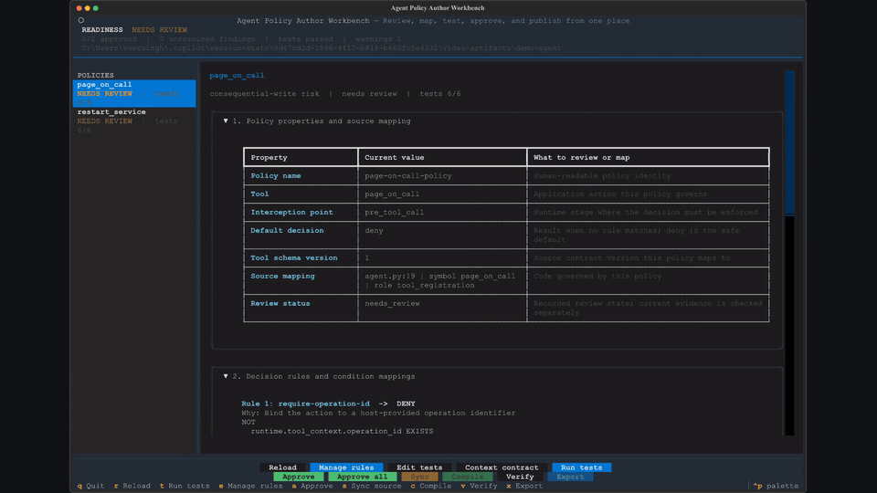

# Agent Policy Author

Agent Policy Author is an open-source, local CLI for authoring portable
authorization policies for tool-using agents. It statically analyzes an
application, inventories agent actions, drafts editable canonical policies,
generates behavioral tests, records human review evidence, and compiles the
reviewed policy to multiple enforcement targets.

The product is local and CLI-only. It does not run an HTTP server, host a web
studio, publish policies, or act as a production policy decision point.

```text
Application source and schemas
              |
              v
    Static action discovery
              |
              v
 Editable canonical workspace
              |
       tests and review
              |
              v
   approval evidence checks
              |
              v
 OPA / Cedar / Cerbos / ACS / Agent Hooks artifacts
```

Agent Policy Author is licensed under the [MIT License](LICENSE.TXT). See
[SECURITY.md](SECURITY.md) for private vulnerability reporting,
[CONTRIBUTING.md](CONTRIBUTING.md) for development guidance,
[CODE_OF_CONDUCT.md](CODE_OF_CONDUCT.md) for community expectations, and
[CHANGELOG.md](CHANGELOG.md) for development history.

## Contents

- [Demo](#demo)
- [What the product does](#what-the-product-does)
- [Installation](#installation)
- [Quick start](#quick-start)
- [Examples](#examples)
- [The three usage paths](#the-three-usage-paths)
- [Command reference](#command-reference)
- [Policy workspace](#policy-workspace)
- [Compilation authority and artifact status](#compilation-authority-and-artifact-status)
- [Architecture deep dive](#architecture-deep-dive)
- [Canonical policy model](#canonical-policy-model)
- [Target adapters](#target-adapters)
- [Persistence and local files](#persistence-and-local-files)
- [Security and governance boundaries](#security-and-governance-boundaries)
- [Supported discovery inputs](#supported-discovery-inputs)
- [Development and validation](#development-and-validation)

## Demo

The excerpt below shows policy review transitioning into the guided rule editor.
Select it to watch the complete narrated walkthrough of discovery, authoring,
behavioral testing, approval, compilation, and portable export.

[](docs/assets/agent-policy-author-demo.mp4)

[Watch the full narrated demo](docs/assets/agent-policy-author-demo.mp4)

## What the product does

Agent Policy Author provides:

- bounded, static discovery of agent tools and their source locations;
- normalization of Python registrations, OpenAPI operations, JSON Schema tool
  manifests, and Agent Hooks traces;
- deterministic recommendations for argument binding, trusted context,
  approval, version, idempotency, and policy-decision controls;
- an editable, engine-neutral canonical policy model;
- generated allow, deny, escalation, and adversarial test cases;
- human review records bound to source, policy, test, and test-result digests;
- compilation to OPA, Cedar, Cerbos, Microsoft Agent Governance Toolkit
  ACS 0.4.0-alpha.1, and Agent Hooks artifacts;
- optional native-engine parity evaluation;
- local SQLite persistence for imported projects, synthesized policies,
  feedback, and tuning suggestions.

It does **not**:

- execute the application being analyzed;
- silently approve generated policy;
- publish policy to a runtime or cloud service;
- prove that every runtime path reaches an enforcement point;
- replace a production identity, approval, or policy administration system;
- treat successful rendering as proof that a native engine accepted the
  result.

Runtime engines and agent hosts remain responsible for authorization
enforcement.

## Installation

Agent Policy Author supports Python 3.11 through 3.13.

### Install with pipx

Install the CLI directly from the repository:

```powershell
pipx install "git+https://github.com/veersingh_microsoft/Agent-Policy-Author.git"
policy-author --version
```

Upgrade an existing installation:

```powershell
pipx upgrade agent-policy-author
```

### Run without a persistent installation

```powershell
uvx --from "git+https://github.com/veersingh_microsoft/Agent-Policy-Author.git" `
  policy-author --help
```

### Install for development

```powershell
git clone https://github.com/veersingh_microsoft/Agent-Policy-Author.git
cd Agent-Policy-Author
python -m venv .venv
.\.venv\Scripts\python -m pip install -e ".[dev]"
```

### Optional native-engine prerequisites

Policy generation does not require native policy engines. Native validation and
cross-engine evaluation additionally require:

| Target path | Optional prerequisite |
|---|---|
| OPA | `opa` executable |
| Cedar | `cedar` executable |
| Cerbos | Docker daemon; a temporary Cerbos container is started and removed |
| Microsoft Agent Governance Toolkit / ACS | `opa` for the generated Rego-backed policy package |
| Agent Hooks | `opa` when evaluating the generated binding with its Rego policy |

Use generation-only workflows when these tools are unavailable.

## Quick start

The recommended workflow starts with `workbench`.

```powershell
policy-author workbench C:\src\my-agent
```

On the first run, this creates `C:\src\my-agent\.agent-policy`, statically
discovers actions, drafts canonical policies and tests, runs the canonical test
suite, and opens a full-screen terminal workbench. The workbench is the primary
developer interface:

- select a policy by clicking it in the left navigator or using the keyboard;
- expand and collapse policy properties, readable decision rules, authoring
  guidance, findings, summarized test results, and raw YAML;
- see each policy property beside guidance explaining what must be reviewed or
  mapped, including source path, line, symbol, and role;
- add, modify, and delete rules with a guided builder that offers discovered
  action arguments, trusted runtime attributes, decisions, operators, and
  all/any matching without requiring canonical YAML;
- edit behavioral tests and inspect the trusted-context contract without
  leaving the workbench, with raw policy YAML retained as an advanced path;
- run tests, synchronize changed source contracts, approve either the selected
  policy or every reviewable policy with one combined evidence packet, compile
  an immutable local bundle, verify its integrity, and export a selected policy
  as an engine-ready ZIP from the action bar.

Workspace discovery warnings remain visible in the workbench. Policies may
contain one or many rules and may intentionally produce only deny, warn,
escalate, or transform outcomes. Approval requires at least one explicit rule
and nonempty passing behavioral tests; an allow outcome is not mandatory. The
authoring guide lists discovered action arguments, trusted context attributes,
safe authoring steps, and the canonical rule shape. Lifecycle controls use two
fixed rows so they remain visible in narrow terminals; keyboard shortcuts also
cover source sync and bundle verification.

Policy review is always scoped to the selected policy. The structured property
and rule views are shown first; raw YAML remains available in a collapsed
advanced section. **Manage rules** opens a guided editor for ordinary rule
creation, modification, and deletion. Persistent labels remain visible after
values are entered, rule details are separated from a larger condition
workspace, and all actions remain reachable in an 80-column terminal. Trusted
context is presented as a runtime-provided choice rather than a value the
policy author must enter. The guided editor validates fixed and list values
against discovered field types before saving. Runtime type mismatches fail
closed with a deny decision instead of terminating policy evaluation. New
rules receive readable, unique internal identifiers automatically; authors
only provide the decision, business justification, and conditions.
Integration owners can use **Context contract** when an authoritative
attribute and resolver must be added. The advanced YAML editor validates YAML
and the canonical policy schema before accepting a policy change, restores the
previous file after an invalid edit, and reruns workspace tests after a valid
save. Use **Approve all** for one combined interactive review packet, or
`approve --tool all` for the equivalent automation path.

Interactive approval keeps accepted-risk details hidden until that disposition
is selected. Risk expiry accepts `YYYY-MM-DD`, `MM/DD/YYYY`, or a full ISO
timestamp; date-only values are normalized to the end of that day in UTC.
Interactive mode never silently approves risk or promotes a local bundle. Finding
dispositions, lossy-semantics acknowledgements, approval snapshots, and
bundle promotion each require explicit confirmation. Use `--no-interactive`
for scripts or the original one-shot status report. For a CI readiness gate,
use `--no-interactive --require-ready`; it exits unsuccessfully unless the
workspace is fully approved and ready to compile. Redirected input and other
non-TTY execution select non-interactive mode automatically; `--interactive`
can be used to force the guided experience.

Later runs reuse the workspace, recalculate readiness, rediscover the source,
and compare its normalized action contracts with the reviewed workspace.

Both `workbench` and the lower-level `init` command fail when discovery finds
no supported actions. Use `--allow-no-actions` only when an empty inventory is
an intentional, reviewed result. A failed `init` does not create a workspace.

When an action, schema, trace, risk classification, trusted-context attribute,
or source reference changes, `workbench` stops before testing or reapproval and
shows the normalized discovery delta. In the workbench, use **Sync source** and
review the exact before/after fields and inventory digests before confirming
that existing approvals will be invalidated. For automation, apply it explicitly:

```powershell
policy-author refresh-workspace C:\src\my-agent\.agent-policy
```

Refresh preserves authored policy rules, merges newly discovered context,
adds newly required arguments to existing fixtures, creates comparison
policies under `.artifacts\reconciliation-suggestions`, archives removed-tool
artifacts, and invalidates prior approval. Testing, approval, and compilation
remain blocked until reconciliation occurs. If refreshed discovery proposes
controls absent from the authored policy, approval also requires those rules
to be merged or the generated reconciliation finding to receive a structured
false-positive or accepted-risk disposition.

Actions whose impact remains `unknown` are review blockers, not silently
excluded actions. Classify them in the source manifest or explicit project
definition and refresh the workspace before testing or approval.

Review the generated policy and its source references:

```powershell
policy-author review C:\src\my-agent\.agent-policy
```

Edit:

```text
.agent-policy\policies\*.yaml
.agent-policy\tests\*.yaml
.agent-policy\context.yaml
```

Rerun the canonical tests:

```powershell
policy-author test-workspace C:\src\my-agent\.agent-policy
```

Record human approval after reviewing the current source, policy, tests, and
test results:

```powershell
policy-author approval-preview C:\src\my-agent\.agent-policy

policy-author approve C:\src\my-agent\.agent-policy `
  --tool all `
  --reviewer developer@contoso.com `
  --reviewer-role service-owner `
  --rationale "Reviewed source, policy rules, and passing tests" `
  --confirm-snapshot "sha256:<digest-from-approval-preview>"
```

If the preview lists semantic acknowledgements, pass every printed
`--acknowledge-lossy TARGET:RULE_ID` flag to both `approval-preview` and
`approve`. Alternatively, reuse the reviewed packet without repeating finding
and acknowledgement flags:

```powershell
policy-author approve C:\src\my-agent\.agent-policy `
  --packet C:\src\my-agent\.agent-policy\approval-packet.json `
  --reviewer developer@contoso.com `
  --reviewer-role service-owner `
  --rationale "Reviewed source, policy rules, and passing tests" `
  --confirm-snapshot "sha256:<digest-from-approval-preview>"
```

The packet contents remain bound into the confirmation digest.

Compile the approved policies:

```powershell
policy-author compile-workspace C:\src\my-agent\.agent-policy
```

The generated target packages are written under:

```text
.agent-policy\generated\<tool>\<target>\
```

Evaluate the promoted OPA package through the fail-closed reference consumer:

```powershell
policy-author evaluate-current `
  C:\src\my-agent\.agent-policy `
  apply_update `
  --context C:\src\my-agent\request-context.json
```

Before OPA runs, the consumer verifies the immutable publication bundle,
requires `action.tool` to match the selected tool, and validates the complete
`action.arguments` object against the packaged JSON Schema. Missing, unknown,
mistyped, or enum-invalid arguments are denied.

If a policy has unresolved blocking findings, approval requires an explicit
disposition:

```powershell
policy-author approve C:\src\my-agent\.agent-policy `
  --tool reserve_inventory_transfer `
  --reviewer developer@contoso.com `
  --reviewer-role service-owner `
  --rationale "Reviewed policy pending source remediation" `
  --finding-disposition "missing_reachable_approval_check=accepted_risk:Owner accepted temporary risk pending host integration" `
  --finding-evidence "missing_reachable_approval_check=issue://123" `
  --finding-expiry "missing_reachable_approval_check=2026-12-31T23:59:59Z" `
  --compensating-control "missing_reachable_approval_check=Host blocks unapproved execution" `
  --confirm-snapshot "sha256:<digest-from-approval-preview>"
```

`false_positive` requires a reviewer role and evidence. `accepted_risk`
additionally requires a future expiry and at least one compensating control.
An expired risk acceptance invalidates the approval. Reviewer identities and
roles are attributable declarations; this local tool does not authenticate
them or replace repository and organization authorization controls.

Trace-derived approval and confirmation rules are scoped to successful traces
that contain both the evidence-producing tool and the governed action in that
order. Evidence observed for one action chain is not reused for unrelated
tools.

## Examples

The repository includes two inert examples. Neither example executes external
side effects.

| Example | Purpose |
|---|---|
| [`examples/discovery-agent`](examples/discovery-agent) | Demonstrates static Python discovery plus Agent Hooks JSONL trace ingestion |
| [`examples/document-update`](examples/document-update) | Demonstrates an explicit normalized project, trusted context, successful traces, and a ready-made runtime context |
| [`examples/incident-response-agent`](examples/incident-response-agent) | Provides a standalone 16-tool agentic incident-response application used by [`quickrun.md`](quickrun.md) |

### Walk through source discovery and workspace authoring

From the repository root:

```powershell
policy-author workbench examples\discovery-agent --no-interactive
policy-author review examples\discovery-agent\.agent-policy
policy-author test-workspace examples\discovery-agent\.agent-policy
policy-author approval-preview examples\discovery-agent\.agent-policy
```

The example should inventory `prepare_update`, `confirm_update`, and
`apply_update`. Only `apply_update` is consequential. Its policy is derived
from the Python signature and the ordered prepare-confirm-apply trace, so its
rules bind the operation, document, value, digest, and positive confirmation
to trusted workflow state.

After reviewing the packet, approve with the exact digest printed by
`approval-preview`:

```powershell
policy-author approve examples\discovery-agent\.agent-policy `
  --tool all `
  --reviewer developer@example.com `
  --reviewer-role service-owner `
  --rationale "Reviewed example policy, context, and passing tests" `
  --confirm-snapshot "sha256:<digest-from-approval-preview>"

policy-author compile-workspace `
  examples\discovery-agent\.agent-policy `
  --require-validated
```

`--require-validated` requires the selected targets to satisfy their declared
native or contract assurance. Omit it when optional native validators are not
installed.

To exercise source reconciliation, copy the example to a temporary directory,
initialize it, then add a required argument to `apply_update` or edit the JSONL
trace. The next `workbench` run reports `NEEDS_RECONCILIATION` and blocks tests,
approval, and compilation until:

```powershell
policy-author refresh-workspace <copied-example>\.agent-policy
```

Refresh preserves the authored policy, writes a comparison policy under
`.artifacts\reconciliation-suggestions`, invalidates approval, and creates an
enforceable reconciliation finding when suggested controls remain absent.

### Evaluate the normalized reference project

The `document-update` example is useful when the normalized inventory and
trusted context are already known:

```powershell
policy-author analyze examples\document-update

policy-author evaluate-engines `
  examples\document-update `
  --tool apply_update `
  --targets opa,cedar,cerbos,agent-hooks,acs `
  --generate-only `
  --output .policy-evaluation
```

Remove `--generate-only` to execute available native validators. The supplied
[`base-context.json`](examples/document-update/base-context.json) contains a
valid `apply_update` request with prepared and confirmed workflow state and can
also be used as the context for a compiled OPA workspace.

## The three usage paths

### 1. Governed workspace authoring

Use this path for policies that developers will maintain and potentially
publish through a separate deployment process:

```text
workbench or init
        |
        v
      review
        |
        v
 edit policies, context, and tests
        |
        v
  test-workspace
        |
        v
      approve
        |
        v
 compile-workspace
```

The `.agent-policy` directory is the source of truth. Approval is explicit and
normal compilation rejects stale evidence.

### 2. Diagnostic action-control analysis

Use `analyze` when you want an inventory and control-gap report without
starting a maintained policy workspace:

```powershell
policy-author analyze C:\src\my-agent
```

This writes `.action-control\` with three outcome areas:

```text
.action-control/
  action-control-report.md
  action-control-report.json
  01-discover/
    capability-inventory.json
  02-identify/
    control-analysis.json
  03-enforce/
    <tool>/
      policy.yaml
      functional-gates.yaml
      scenarios.json
      canonical-verification.json
```

Use `--json` to print the complete machine-readable report:

```powershell
policy-author analyze C:\src\my-agent --json
```

The report separates:

| Section | Meaning |
|---|---|
| `inventory` | Discovered tools, schemas, risk metadata, and source locations |
| `control_analysis` | Existing, proposed, partial, or unknown control requirements |
| `enforcement` | Generated policy-package and test outcomes for policy candidates |

A reported gap is a review item, not automatically a confirmed vulnerability.
Static discovery may not see controls implemented by an external host,
middleware layer, or runtime.

### 3. Cross-engine evaluation

Use `evaluate-engines` to compare canonical decisions with generated native
targets:

```powershell
policy-author evaluate-engines `
  examples\discovery-agent `
  --tool apply_update `
  --targets opa,cedar,cerbos,agent-hooks,acs `
  --output .policy-evaluation
```

When native tools are not installed, generate the packages without claiming an
engine verification pass:

```powershell
policy-author evaluate-engines `
  examples\discovery-agent `
  --tool apply_update `
  --targets opa,cedar,cerbos,agent-hooks,acs `
  --generate-only `
  --output .policy-evaluation
```

Generation and evaluation have independent states. A generation-only result
uses `compilation_status=passed`, `evaluation_status=not_run`, and
`overall_status=partial`.

See [docs/cross-engine-evaluation.md](docs/cross-engine-evaluation.md) for the
scenario model and parity semantics.

## Command reference

| Command | Purpose |
|---|---|
| `workbench <source-or-workspace>` | Open the interactive authoring lifecycle in a TTY, emit a one-shot report with `--no-interactive`, or enforce readiness with `--require-ready` |
| `init <source>` | Create an editable `.agent-policy` workspace |
| `refresh-workspace <workspace>` | Reconcile changed source contracts while preserving authored policy |
| `review <workspace>` | Show review state, source locations, questions, and approval evidence |
| `approval-preview <workspace>` | Write the complete reviewer packet and confirmation digest |
| `test-workspace <workspace>` | Evaluate the workspace's canonical test cases |
| `approve <workspace>` | Record attributable approval evidence |
| `compile-workspace <workspace>` | Compile reviewed workspace policies to configured targets |
| `verify-bundle <bundle>` | Verify bundle integrity, optionally requiring complete validation |
| `export-policy <workspace> <tool>` | Export one target package from the verified authoritative bundle as a ZIP |
| `evaluate-current <workspace> <tool>` | Evaluate the current OPA bundle through the fail-closed reference consumer |
| `analyze <source>` | Generate the three-phase diagnostic action-control report |
| `discover <directory>` | Write normalized inventory, proposals, traces, and unresolved questions |
| `import-project <project.yaml>` | Import a normalized project into local SQLite storage |
| `recommend <project>` | Show deterministic recommendations for an imported project |
| `synthesize <project> <tool>` | Write a canonical policy for one imported tool |
| `test <policy> --context <context.json>` | Generate and run canonical tests for one policy |
| `compile-draft <project> <policy>` | Render explicitly unapproved draft target artifacts |
| `evaluate-engines <source>` | Generate and optionally execute cross-engine parity scenarios |
| `feedback <project> <policy>` | Record local false-positive, false-negative, or review feedback |
| `tune <project> <policy>` | Summarize deterministic tuning suggestions from recorded feedback |

Run command-specific help for all options:

```powershell
policy-author workbench --help
policy-author compile-workspace --help
policy-author evaluate-engines --help
```

The former `compile` command remains as a hidden, deprecated compatibility
alias for `compile-draft`.

`compile-workspace` promotes an immutable bundle only inside the local
workspace; it does not deploy policy to a remote service or runtime. Packaged
builds carrying dirty source provenance are rejected by default. Use
`--allow-dirty-product` only for deliberate local development validation; the
acknowledgement is recorded in the bundle manifest.

## Policy workspace

The workspace is deliberately small, text-based, and suitable for source
control:

```text
.agent-policy/
  policy-author.yaml
  project.yaml
  actions.yaml
  context.yaml
  review.yaml
  approval-packet.json
  test-results.json
  workbench-report.json
  policies/
    <tool>.yaml
  tests/
    <tool>.yaml
  generated/
    compilation-report.json
    last-attempt.json
    current.json
    bundles/
      <sha256>/
        publication-manifest.json
    <tool>/
      opa/
      cedar/
      cerbos/
      agent-hooks/
      acs/
```

| File | Responsibility |
|---|---|
| `policy-author.yaml` | Source path, policy/test directories, generated directory, and target selection |
| `project.yaml` | Normalized tools, schemas, context contract, traces, and discovered controls |
| `actions.yaml` | Action inventory and policy applicability |
| `context.yaml` | Developer-editable trusted-context contract |
| `review.yaml` | Questions, warnings, review status, and approval evidence |
| `approval-packet.json` | Reviewer-visible policies, tests, findings, target fidelity, and confirmation digest |
| `policies/*.yaml` | Canonical policy source of truth |
| `tests/*.yaml` | Canonical allow, deny, escalation, and adversarial expectations |
| `test-results.json` | Current test evidence bound to the source revision |
| `workbench-report.json` | Current readiness and suggested next commands |
| `generated/bundles/<sha256>/` | Immutable authoritative bundle with byte-level artifact hashes and complete approval evidence |
| `generated/current.json` | Atomic pointer to the accepted authoritative bundle |
| `generated/<tool>/<target>/` | Convenience view updated only after a bundle is accepted |
| `generated/compilation-report.json` | Report for the currently promoted publication |
| `generated/last-attempt.json` | Most recent compile attempt, including rejected attempts |

`policies/` and `tests/` are authored inputs. `generated/` can be deleted and
rebuilt.

Initialization accepts either a repository directory or an individual source
file:

```powershell
policy-author init C:\src\my-agent
policy-author init C:\src\my-agent\agent.py --output C:\policy\my-agent
```

When possible, `policy-author.yaml` stores the source relative to the
workspace, so moving or cloning the source and `.agent-policy` together keeps
the binding valid. Cross-drive sources are explicitly marked
`external_absolute`; legacy workspaces without a source mode must be
reinitialized rather than silently following an unsafe absolute path.

Select targets when creating a workspace:

```powershell
policy-author init C:\src\my-agent `
  --targets opa,cedar,cerbos,agent-hooks,acs
```

## Compilation authority and artifact status

Agent Policy Author separates reviewed compilation from low-level draft
rendering.

### Authoritative workspace compilation

`compile-workspace` verifies, for each policy:

1. the policy is marked `approved`;
2. approval evidence is present;
3. source, project, authoritative `context.yaml`, workspace configuration,
   policy, tests, test results, findings, target scope, adapter identities, and
   product version match the approved snapshot;
4. at least one current test exists and all current tests pass;
5. selected targets are a subset of the approved target scope.
6. accepted-risk dispositions have not expired;
7. every lossy target translation was explicitly acknowledged.

Editing any approval-bound input makes approval stale and blocks compilation.
There is no draft override on `compile-workspace`.

Successful compilation stages and validates every target before creating an
immutable bundle. Verify a bundle before promotion or consumption:

```powershell
policy-author verify-bundle C:\src\my-agent\.agent-policy\generated\bundles\<sha256>
```

The default `portable` publication profile permits targets whose native
validator is not installed and marks the bundle `verified: false`. Use
`compile-workspace --require-validated` for release gates that require every
selected target's declared validation assurance to succeed. Use
`--require-exact-semantics` to reject fail-closed lowering as well as
unsupported semantics. Failed targets are printed with the affected canonical
rule IDs and fidelity classifications so developers can remediate the policy
or choose a compatible target without opening the JSON compilation report.

`verify-bundle` always verifies immutable bytes, artifact hashes, and manifest
digests. This is **integrity verification**, not a claim that native validators
ran. Add `--require-validated` when the consumer requires both properties.

### Draft compilation

`compile-draft` is intended for adapter development and compatibility
inspection:

```powershell
policy-author import-project .\examples\document-update\project.yaml
policy-author synthesize document-update apply_update --output policy.yaml
policy-author compile-draft document-update policy.yaml --targets opa,cedar
```

Draft output is written beneath:

```text
.artifacts/
  drafts/
    <project>/
      <policy>/
        <version>/
          <target>/
            draft-manifest.json
```

Every draft manifest includes:

```json
{
  "authority": "draft",
  "approved": false,
  "review_status": "needs_review"
}
```

Draft artifacts must not be published as reviewed policy.

### Rendering versus native validation

Compilation reports target status separately:

- `validated`: the target's declared validator accepted the package;
- `validation_not_run`: the package rendered and structured files parsed, but
  no native validator was available or configured;
- `failed`: rendering or native validation failed.

OPA and Cedar use native assurance when their executables are available.
Microsoft Agent Governance Toolkit ACS, Agent Hooks, and Cerbos use contract
assurance that validates the generated
binding or resource-policy contract without claiming native engine execution.
Validator evidence records assurance, executable and version where applicable,
platform, timeout, timestamps, and a result digest.
The CLI prints the assurance beside each result, for example
`opa=validated[native]` or `agent-hooks=validated[contract]`, and separately
reports whether every selected target received native validation.

Engine parse, request, schema, timeout, and process failures remain explicit
errors. They are never converted into policy denies or success-shaped results.

## Architecture deep dive

### Design principles

The implementation follows six core principles:

1. **Canonical intent is the source of truth.** Target-language output is
   generated and replaceable.
2. **Discovery is static and bounded.** The analyzed application is not
   imported or executed.
3. **Recommendations are deterministic.** Policy proposals derive from source,
   schemas, traces, and declared trust, not from an unbounded model decision.
4. **Approval is evidence-bound.** Review state is invalidated when relevant
   source or authoring inputs change.
5. **Adapters fail closed on unsupported semantics.** A target must report
   incompatibility instead of silently weakening required behavior.
6. **Runtime consumption is explicit.** Every target includes an integration
   contract; the reference OPA consumer resolves `current.json`, verifies the
   immutable bundle, validates the selected action and complete arguments
   against the packaged schema, enforces a timeout, validates the decision
   shape, and fails closed on any resolver, integrity, schema, engine, or
   response error.

### Package layout

```text
src/policy_authoring/
  cli.py               CLI commands and terminal reporting
  config.py            Local data and artifact directory configuration
  service.py           Low-level imported-project and draft-rendering service
  discovery/            Static scanners, trace normalization, and proposals
  domain/               Typed canonical models, validation, and evaluator
  recommendation/       Deterministic rule synthesis
  testing/              Test generation and synthetic trusted context
  workspace/            Maintained lifecycle, approval, tests, and compilation
  adapters/             OPA, Cedar, Cerbos, ACS, and Agent Hooks compilers
  analysis/             Three-phase diagnostic action-control workflow
  evaluation/           Native cross-engine parity harness
  ingestion/            Safe YAML/JSON project and policy loading
  storage/              SQLite project, policy, feedback, and tuning repository
```

### Layer 1: CLI

`cli.py` is the only product-facing process interface. It:

- parses paths, targets, and lifecycle options with Typer;
- converts domain errors into explicit nonzero command outcomes;
- prints concise human-readable summaries by default;
- emits full JSON only for commands that expose a `--json` mode;
- delegates behavior to workspace, analysis, evaluation, or service modules.

The CLI contains no policy semantics. Business rules remain in the underlying
modules so they can be tested independently.

### Layer 2: Static discovery

The discovery subsystem reads supported source and manifest files beneath a
bounded root. It produces a normalized `ProjectDefinition` containing:

- tool names and descriptions;
- JSON input schemas;
- mutation and approval metadata;
- source file, line, symbol, and role references;
- context attributes and trust classifications;
- normalized traces;
- observed control evidence.

For Python, discovery uses syntax and bounded call relationships rather than
importing the target module. Generated directories, dependency directories,
hidden paths, and symlinks are excluded from the scan.

The discovery result can feed:

- a maintained workspace through `init` or `workbench`;
- a diagnostic bundle through `discover` or `analyze`;
- the cross-engine evaluation harness.

Existing workspaces are rediscovered before tests, approval, and compilation.
Normalized changes to tools, schemas, risks, source references, context,
controls, or traces produce `discovery-reconciliation.json` and block the
lifecycle until `refresh-workspace` explicitly applies the new inventory.
Actions whose risk remains unknown are unresolved governance work and block
readiness rather than being treated as not applicable.

### Layer 3: Canonical domain

The domain layer defines strict Pydantic models for projects, policies, rules,
conditions, context contracts, tests, compilation results, reviews, and
approval evidence.

A canonical policy describes:

- metadata and review status;
- the governed tool and schema version;
- the interception point;
- a default decision;
- source targets;
- ordered rules;
- typed condition trees.

The canonical evaluator executes this representation directly for behavioral
tests. It is a reference evaluator for authoring and parity checks, not a
production authorization service.

### Layer 4: Recommendation and synthesis

The recommendation subsystem examines normalized schemas, traces, trusted
context, and observed controls. It generates deterministic recommendations
such as:

- restrict an argument to observed safe values;
- bind an operation, resource, digest, value, or version to trusted state;
- require positive approval or confirmation;
- reject missing idempotency or version evidence;
- place a policy decision before a consequential tool call.

Trace-derived evidence is action-chain scoped. A confirmation or approval tool
contributes controls only when successful traces for the governed action place
that evidence-producing step before the action. Evidence from one workflow is
never inferred as authorization for an unrelated tool.

Synthesis converts accepted deterministic recommendations into a canonical
policy. New policies start with:

```yaml
metadata:
  review_status: needs_review
```

Generation is a proposal, never an approval.

### Layer 5: Test generation

The testing subsystem derives canonical cases from policy rules and a trusted
base context. It creates:

- a valid action satisfying all generated constraints;
- one or more mutations intended to trigger each rule;
- expected allow, deny, warn, escalate, or transform outcomes;
- matched-rule and decision-reason evidence.

Diagnostic mutations are schema-aware: scenarios mutate only action arguments
and trusted-context fields that exist in the discovered contract. Schema-gate
failures remain distinct from canonical rule failures. `analyze`,
`evaluate-engines`, and the installed runtime consumer use the same complete
Draft 2020-12 JSON Schema gate. Analysis results identify whether a decision
was produced by schema validation or by canonical policy evaluation.

Workspace test results are persisted with the current source revision. Normal
approval and compilation require nonempty, passing, current evidence.

### Layer 6: Review and approval

The workspace subsystem owns the maintained governance lifecycle.

Approval evidence records:

- reviewer identity;
- optional reviewer role;
- approval time;
- rationale;
- source revision;
- policy digest;
- test digest;
- test-result digest;
- selected targets;
- disposition of unresolved blocking findings.

Before approval, source reconciliation can create enforceable findings for
newly suggested controls that remain absent from the authored policy. Each
finding must be resolved by merging the controls or by a structured
false-positive or accepted-risk disposition. Approval packets bind those
dispositions and semantic acknowledgements into the confirmation digest.
Disposition semantics are canonicalized before confirmation. Reviewer-derived
ownership is retained as approval attribution without mutating the confirmed
finding or snapshot digest, so a successful approval remains immediately
compilable.

Review output distinguishes the digest of an already approved packet from the
digest of a newly generated prospective packet. This prevents a later preview
from being mistaken for the evidence that authorized the current policy.

The policy digest excludes the mutable `review_status` field so changing the
status during approval does not invalidate the policy content being approved.

Source revision is calculated from supported source and configuration files
while excluding the workspace itself. This prevents regenerated workspace
files from changing the source digest.

### Layer 7: Target adapters

Adapters implement a shared compilation protocol. Each adapter:

1. declares or checks supported canonical capabilities;
2. reports rule-level compatibility;
3. generates deterministic artifacts;
4. retains canonical rule identifiers;
5. emits source maps or runtime bindings;
6. returns structured compilation metadata.

The registry currently loads:

```text
Agent Hooks
OPA
Cedar
Cerbos
ACS
```

Workspace compilation writes all packages to a temporary directory, validates
them, creates a digest-addressed immutable bundle with a publication manifest,
verifies that bundle, atomically updates `current.json`, and only then refreshes
the `generated/<tool>/<target>` convenience views. Failed runs are quarantined
under `generated/failures/` and do not replace last-known-good output.

Every target package includes an integration contract describing its
entrypoint, tool argument schema, trusted context, decision shape, and failure
behavior. The installed OPA reference consumer verifies this contract and
performs JSON Schema validation before engine invocation.

### Layer 8: Analysis and evaluation

The analysis workflow presents discovery and generation as three reviewable
outcomes:

1. **Discover:** what actions and controls exist?
2. **Identify:** what control requirements are existing, partial, proposed, or
   unknown?
3. **Enforce:** what canonical policy, gates, and scenarios were generated?

The evaluation workflow sends identical scenarios through the canonical
evaluator and selected target engines. It records both policy decisions and
whether the simulated side effect executed. Only an effective allow may reach
the side effect.

### Layer 9: Persistence

The low-level imported-project workflow uses SQLite. The repository stores:

- normalized projects;
- policies keyed by `(project_name, policy_name, version)`;
- feedback keyed to project, policy, and optional rule.

Every operation opens a scoped connection, commits or rolls back explicitly,
and closes the connection deterministically. SQLite is a local convenience
store; the maintained `.agent-policy` workspace remains the developer-managed
source of truth.

### End-to-end data flow

```text
Source code / OpenAPI / JSON Schema / traces
                      |
                      v
              ProjectDefinition
                      |
             +--------+--------+
             |                 |
             v                 v
      Action inventory   Trusted context contract
             |                 |
             +--------+--------+
                      |
                      v
       Deterministic recommendations
                      |
                      v
             CanonicalPolicy YAML
                      |
             +--------+--------+
             |                 |
             v                 v
       Canonical tests    Human review record
             |                 |
             +--------+--------+
                      |
              digest validation
                      |
                      v
              Adapter registry
                      |
       +-------+------+------+--------+
       |       |      |      |        |
      OPA    Cedar  Cerbos   ACS  Agent Hooks
```

## Canonical policy model

Example:

```yaml
metadata:
  name: create-replacement-purchase-order-policy
  version: 1
  review_status: needs_review
tool: create_replacement_purchase_order
schema_version: "1"
interception_point: pre_tool_call
default_decision: deny
source_targets:
  - path: src/enterprise_operations_agent/tools/procurement.py
    line: 109
    symbol: create_replacement_purchase_order
    role: tool_registration
rules:
  - id: bind-operation-id
    decision: deny
    reason: operation_id differs from trusted workflow state
    condition:
      operator: not_equals
      left:
        path: action.arguments.operation_id
      right:
        path: workflow.prepared.operation_id
```

`source_targets` provide review provenance. They identify where the governed
action was discovered but do not prove that the runtime is already wired to an
enforcement point.

Condition trees support equality, membership, existence, comparison, and
logical composition. Canonical validation rejects undeclared context paths and
malformed operator inputs before adapter compilation. It also rejects
duplicate policy rule IDs, project tool names, context attribute paths, trace
IDs, review action tools, and policy test IDs so audit evidence cannot be
silently collapsed by map-based processing.

## Target adapters

| Target | Generated role |
|---|---|
| OPA | Rego policy package, context mapping, tests, and source map |
| Cedar | Cedar policy, schema, request fixtures, and source mapping |
| Cerbos | Cerbos resource-policy YAML and test fixtures |
| ACS | Microsoft Agent Governance Toolkit ACS 0.4.0-alpha.1 manifest and OPA-backed policy package |
| Agent Hooks | Interception binding, context mapping, verdict mapping, and conformance fixtures |

ACS and Agent Hooks are integration contracts rather than standalone policy
engines. Their evaluation paths use the generated OPA policy package with the
corresponding runtime mapping. Agent Hooks bindings contain a package-relative
OPA reference that is resolved and checked during compilation; references
outside the published tool package are rejected.

The stable internal target identifier and generated directory name for
Microsoft Agent Governance Toolkit is `acs`. In the workbench it is displayed
as **Microsoft Agent Governance Toolkit (AGT / ACS)**. After compilation,
select a policy, choose **Export**, select the target engine, and save the
engine-ready ZIP. The export is copied only from the verified immutable bundle,
not from draft artifacts.

Automation can export the same package without opening the workbench:

```powershell
policy-author export-policy C:\src\my-agent\.agent-policy page_on_call `
  --target acs `
  --output C:\exports\page-on-call-agt.zip
```

Adapters must retain canonical rule IDs and report unsupported behavior
explicitly. They must not omit a required rule merely to produce syntactically
valid output.

## Persistence and local files

Default local paths:

| Path | Purpose |
|---|---|
| `.agent-policy/` | Maintained authoring workspace |
| `.action-control/` | Diagnostic analysis bundle |
| `.policy-authoring/` | Lower-level discovery output |
| `.policy-evaluation/` | Cross-engine evaluation output |
| `.data/policy-authoring.db` | Imported projects, policies, and feedback |
| `.artifacts/drafts/` | Explicitly unapproved low-level compilation output |

Override service storage paths with environment variables:

```powershell
$env:POLICY_AUTHOR_DATA_DIR = "C:\policy-author\data"
$env:POLICY_AUTHOR_ARTIFACT_DIR = "C:\policy-author\artifacts"
```

Project and policy data is local. No credentials or cloud connection are
required.

## Security and governance boundaries

The product uses these boundaries:

- source discovery is static, bounded, and non-executing;
- YAML input uses safe loading followed by strict model validation;
- generated artifact paths are resolved beneath configured roots;
- context attributes declare whether their source is authenticated,
  resolver-provided, workflow-provided, model-provided, or untrusted;
- policy generation begins in `needs_review`;
- normal compilation requires current approval and test evidence;
- unsupported target semantics produce incompatibility, not weakened output;
- engine failures remain errors rather than authorization decisions;
- the product does not publish policy or execute production side effects.

Approval evidence in a local workspace is review metadata, not a
nonrepudiable governance attestation. Organizations requiring stronger
separation of duties should connect the generated policy and evidence to an
external authenticated review and publication system.

## Supported discovery inputs

- Python `tool`, `function_tool`, `kernel_function`, and `ai_function`
  decorators;
- Python constructor registrations such as `ToolSpec(...)`;
- Python type annotations, including `Literal` enumerations;
- OpenAPI operations;
- JSON Schema and MCP-style tool manifests;
- authoritative `mutating` and `requires_approval` manifest metadata;
- Agent Hooks JSON and JSONL traces;
- existing Agent Policy Author project definitions;
- bounded local helper-call evidence for mutation, version, idempotency,
  approval, operation binding, and audit controls.

Discovery does not import project modules, execute repository code, or follow
symlinks. If no supported tools are found, analysis returns
`not_applicable`. `workbench` and `init` exit unsuccessfully in this case by
default so automation cannot silently accept an empty inventory; use
`--allow-no-actions` when the empty result is intentional. Candidate Agent
Hooks JSON and JSONL trace files are strict inputs: malformed records fail
discovery with the file and JSONL line/column rather than being treated as
absent evidence. Supported JSONL trace files participate in the source
revision, so editing one invalidates stale test and approval evidence.

## Development and validation

Run the local validation suite:

```powershell
python -m venv .venv
.\.venv\Scripts\python -m pip install -e ".[dev]"
.\.venv\Scripts\ruff check .
.\.venv\Scripts\mypy src tests
.\.venv\Scripts\pytest -m "not native_engines"
.\.venv\Scripts\python -m build
```

Run the native reference evaluation when OPA, Cedar, and Docker are available:

```powershell
docker pull ghcr.io/cerbos/cerbos:0.46.0
.\.venv\Scripts\policy-author evaluate-engines `
  examples\discovery-agent `
  --tool apply_update `
  --targets opa,cedar,cerbos,agent-hooks,acs `
  --output .policy-evaluation
```

The reference evaluation exercises 11 valid and adversarial scenarios across
the canonical evaluator, OPA, Cedar, Cerbos, Agent Hooks + OPA, and ACS + OPA.

Further documentation:

- [Policy workspace lifecycle](docs/policy-workspace.md)
- [Cross-engine evaluation](docs/cross-engine-evaluation.md)
- [Governance roadmap](docs/governance-roadmap.md)

## Privacy and telemetry

Agent Policy Author does not collect telemetry or send source code, policy
content, traces, reviewer information, or usage data to Microsoft. Project
analysis and workspace persistence are local. Users remain responsible for
protecting confidential information and personal data in the repositories,
traces, policies, and evidence they choose to process or share.

## Security reporting

Do not report suspected vulnerabilities through a public issue. Follow the
private reporting instructions in [SECURITY.md](SECURITY.md).

## Code of conduct

This project has adopted the
[Microsoft Open Source Code of Conduct](https://opensource.microsoft.com/codeofconduct/).
For more information, see the
[Code of Conduct FAQ](https://opensource.microsoft.com/codeofconduct/faq/) or
contact [opencode@microsoft.com](mailto:opencode@microsoft.com).

## Trademarks

This project may contain trademarks or logos for projects, products, or
services. Authorized use of Microsoft trademarks or logos is subject to and
must follow
[Microsoft's Trademark & Brand Guidelines](https://www.microsoft.com/en-us/legal/intellectualproperty/trademarks).
Use of Microsoft trademarks or logos in modified versions of this project must
not cause confusion or imply Microsoft sponsorship. Any use of third-party
trademarks or logos is subject to those third parties' policies.
